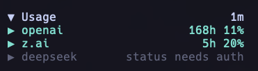
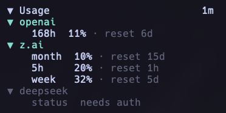
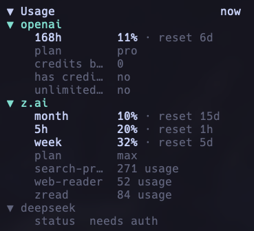

# opencode-usage-monitor

[English version](README.md)

> OpenCode TUI sidebar plugin, который показывает квоты и баланс OpenAI, Z.AI / GLM, DeepSeek и OpenCode Go без раскрытия provider credentials в UI.

[](https://www.npmjs.com/package/opencode-usage-monitor)


| Поле | Значение |
|---|---|
| Статус | Активно поддерживаемый персональный OpenCode tool/plugin |
| Тип | OpenCode TUI plugin / host extension |
| Host app | Документирован OpenCode `>= v1.14.49`; peer dependency `@opencode-ai/plugin >=1.15.0` |
| Package | `opencode-usage-monitor` `2.0.1` package metadata |
| Runtime | Bun `>= 1.1.0` документирован для локальной разработки |
| Проверки maintainer | `bun install && bun run build:all && bun test && bun run typecheck` |

## Скриншоты

Plugin отображается внутри sidebar терминального UI OpenCode.







## Сводка

- Показывает usage windows OpenAI ChatGPT, например 5h/week, со временем reset и опциональными деталями plan или credits.
- Показывает quota windows Z.AI и GLM 5h/week/month со временем reset и опциональными деталями plan. Поддерживает enterprise/org coding plans через organization и project scoping.
- Показывает баланс аккаунта DeepSeek в CNY с опциональной детализацией granted/topped-up.
- Показывает usage windows OpenCode Go 5h/week/month со временем reset.
- Стандартизирует provider output как explicit usage windows плюс typed provider-owned details; баланс DeepSeek отображается как balance detail, а не как fake reset window.
- Находит credentials в OpenCode auth storage и поддерживаемых environment variables.
- Редактирует secrets из error messages перед выводом в TUI.
- Отклоняет raw provider attribute dumps в runtime snapshots; providers должны мапить safe attributes в ordered details.
- Использует stale-data indicators и guarded refreshes, чтобы не запускать пересекающиеся API calls.
- Поддерживает двухуровневое collapse/expand поведение: весь panel и детализация по provider.

## Быстрый старт

```sh
# установить опубликованный OpenCode plugin глобально
opencode plugin opencode-usage-monitor@latest --global --force

# опционально: собрать из локального checkout для разработки
git clone https://github.com/Mark1708/opencode-usage-monitor.git
cd opencode-usage-monitor
bun install
bun run build:all
```

## Установка

### Установка OpenCode plugin

```sh
opencode plugin opencode-usage-monitor@latest --global --force
```

Это рекомендуемый путь для пользователей: plugin опубликован в npm, и OpenCode может установить его напрямую.

### Установка package для локальной разработки

```sh
bun add opencode-usage-monitor
```

Используйте этот вариант, если package нужен в локальном development workspace, а не глобально внутри OpenCode.

### Локальный checkout

```sh
git clone https://github.com/Mark1708/opencode-usage-monitor.git
cd opencode-usage-monitor
bun install
bun run build:all
```

Build создаёт plugin entry и TUI bundle в `dist/`.

### Локальная установка в OpenCode без npm publish

Для тестирования release candidate соберите и упакуйте локальный checkout, затем установите созданный tarball в global OpenCode config:

```sh
bun run build:all
npm pack
opencode plugin "$(pwd)/opencode-usage-monitor-2.0.1.tgz" --global --force
```

Это обновляет server и TUI plugin entries, если ваша версия OpenCode CLI поддерживает plugin installer. Если команда `opencode plugin` недоступна, добавьте built package или tarball path в OpenCode config вручную.

## Совместимость

| Компонент | Поддерживаемая версия | Источник |
|---|---|---|
| Host app | OpenCode `>= v1.14.49` | README compatibility note |
| Plugin API | `@opencode-ai/plugin >=1.15.0` | `package.json` peer dependency |
| TUI runtime | `@opentui/keymap >=0.2.10`, `@opentui/solid >=0.2.10`, `solid-js >=1.9.12` | `package.json` peer dependencies |
| Local runtime | Bun `>=1.1.0` | README requirements; Bun-based scripts в `package.json` |
| TypeScript | `^5.5.0` | `package.json` dev dependency |

## Конфигурация

Version 2.0 поддерживает только versioned configuration contract. Legacy flat fields вроде `show_openai`, `show_zai`, `show_deepseek` и `refresh_ms` отклоняются с actionable configuration error в TUI вместо fallback-интерпретации.

Plugin сначала читает отдельный config-файл:

```text
~/.config/opencode/usage-monitor.json
```

Минимальная полезная конфигурация:

```json
{
  "version": 2,
  "providers": {
    "openai": {},
    "zai": {},
    "deepseek": {},
    "opencode-go": {}
  }
}
```

Полная документированная форма:

```json
{
  "version": 2,
  "enabled": true,
  "keybindings": {
    "refresh_all": "<leader>q",
    "refresh_provider": null
  },
  "ui": {
    "width": 34,
    "symbols": "unicode",
    "panel_initial_state": "expanded",
    "provider_initial_state": "collapsed"
  },
  "refresh": {
    "mode": "automatic",
    "interval_ms": 300000,
    "timeout_ms": 15000,
    "stale_after_ms": 600000
  },
  "diagnostics": {
    "debug": false
  },
  "providers": {
    "openai": {
      "credential": { "source": "opencode", "entry": "openai" }
    },
    "zai": {
      "credential": { "source": "opencode", "entry": "zai-coding-plan" },
      "options": { "plan": "personal" }
    },
    "deepseek": {
      "credential": { "source": "opencode", "entry": "deepseek" }
    },
    "opencode-go": {
      "credential": { "source": "opencode", "entry": "opencode-go" }
    }
  }
}
```

Объект `providers` управляет provider activation. Наличие provider включает его; отсутствие отключает и предотвращает credential, cache и network work для этого provider. Provider-specific refresh policies намеренно не поддерживаются.

Альтернативно можно добавить секцию `usage_monitor` в `oh-my-openagent.json`. Значения из отдельного `usage-monitor.json` имеют приоритет.

## Credentials

### OpenAI

OpenAI показывает ChatGPT/Codex subscription quota windows из OpenCode OAuth session, а не из OpenAI Platform API keys. Plugin читает OpenCode auth storage и использует:

```text
$.openai.access
$.openai.accountId
$.openai.expires
$.openai.type == "oauth"
```

Auth file находится через OS-neutral OpenCode data paths, начиная с `${XDG_DATA_HOME}/opencode/auth.json`, затем `~/.local/share/opencode/auth.json`, legacy config locations и Windows local/roaming app data paths. `OPENAI_API_KEY` и `OPENAI_ADMIN_KEY` не используются для subscription quota.

### Z.AI и GLM

Plugin поддерживает Z.AI и Zhipu / GLM credentials из OpenCode auth storage или environment variables:

```sh
export ZAI_API_KEY="your-zai-key"
export ZAI_CODING_PLAN_API_KEY="your-coding-plan-key"
export ZHIPU_API_KEY="your-zhipu-key"
export ZHIPUAI_API_KEY="your-zhipuai-key"
```

#### Enterprise / organization coding plan

Enterprise (organization-scoped) GLM coding plans требуют organization id и project id. Когда оба значения заданы, plugin запрашивает `{baseUrl}/api/monitor/usage/quota/limit?type=2` с headers `Bigmodel-Organization` и `Bigmodel-Project`; иначе используется personal plan endpoint.

Настройка в `usage-monitor.json`:

```json
{
  "version": 2,
  "providers": {
    "zai": {
      "options": {
        "plan": "enterprise",
        "organization_id": "your-org-id",
        "project_id": "your-project-id"
      }
    }
  }
}
```

Или через environment variables, если provider options не заданы:

```sh
export ZHIPU_ORGANIZATION_ID="your-org-id"
export ZHIPU_PROJECT_ID="your-project-id"
```

### DeepSeek

Plugin показывает баланс аккаунта DeepSeek в CNY из balance endpoint. Настройте API key через OpenCode auth storage или:

```sh
export DEEPSEEK_API_KEY="your-deepseek-key"
```

Balance row показывает общий CNY amount; раскрытие provider показывает granted (promotional) и topped-up (paid) breakdown.

### OpenCode Go

OpenCode Go показывает usage windows 5h, weekly и monthly через first-party usage endpoint. Endpoint реализован и развернут, но не документирован как стабильный public API. Используется API key из OpenCode auth entry `opencode-go` или environment variable:

```sh
export OPENCODE_API_KEY="your-opencode-go-key"
```

## Использование

- Нажмите на основной usage header, чтобы свернуть или раскрыть весь panel.
- Нажмите на строки providers, чтобы независимо переключать provider details.
- Используйте `/usage-refresh` или настроенный refresh keybind, по умолчанию `<leader>q`, для ручного refresh.
- Runtime refreshes используют account-safe provider cache в `/tmp/opencode-usage-monitor-v2/`.
- Render errors перехватываются и отображаются внутри error boundary.

## Структура проекта

```text
.
├── assets/                    # Local screenshots для README
├── dist/                      # Собранный package output
├── src/
│   ├── auth.ts                # OpenCode auth и environment credential discovery
│   ├── provider-cache.ts      # Account-safe provider cache
│   ├── runtime-config.ts      # Versioned runtime config parsing and validation
│   ├── credentials.ts         # Credential resolver for provider registrations
│   ├── index.ts               # OpenCode plugin entry
│   ├── refresh*.ts            # Runtime refresh coordinator modules
│   ├── sanitize.ts            # Helpers для secret redaction
│   ├── snapshot-validation.ts # Snapshot validation before publication/cache
│   ├── tui.ts                 # TUI plugin module
│   ├── providers/             # OpenAI, Z.AI / GLM, DeepSeek и OpenCode Go provider clients
│   └── views/                 # Helpers для TUI view rendering
├── package.json               # Package metadata, scripts, peer dependencies
├── tsconfig.json              # Strict TypeScript config
└── LICENSE
```

## Устранение неполадок

- Если OpenAI показывает `auth missing`, `oauth missing`, `oauth expired` или `account id missing`, выполните `opencode providers login` для OpenAI и проверьте, что OpenCode auth entry содержит non-expired OAuth `openai.access`, `openai.accountId`, `openai.expires` и `openai.type: "oauth"`.
- Если Z.AI показывает `auth missing`, настройте поддерживаемую Z.AI или Zhipu environment variable либо OpenCode auth entry.
- Если Z.AI показывает `partial` на enterprise/org account, задайте `providers.zai.options.organization_id` и `providers.zai.options.project_id` или `ZHIPU_ORGANIZATION_ID` / `ZHIPU_PROJECT_ID`, чтобы использовался endpoint `?type=2`.
- Если DeepSeek показывает `auth missing`, задайте `DEEPSEEK_API_KEY` или добавьте DeepSeek entry в OpenCode `auth.json`.
- Если OpenCode Go показывает `auth missing`, выполните `/connect` в OpenCode, выберите OpenCode Go и введите API key. OpenCode сохранит его в auth entry `opencode-go`; либо задайте `OPENCODE_API_KEY`.
- Если panel показывает `config` error, мигрируйте `usage-monitor.json` на `version: 2` shape и задайте хотя бы один provider в `providers`.
- Если panel слишком широкий или узкий, измените `ui.width` в `usage-monitor.json`.
- Если refresh выглядит устаревшим, уменьшите `refresh.interval_ms` или проверьте provider API connectivity.
- Если build output отсутствует, выполните `bun run build:all` и проверьте наличие `dist/index.js` и `dist/tui.js`.
- Если cached data выглядит устаревшей, проверьте `/tmp/opencode-usage-monitor-v2/`.

## Ограничения / безопасность

- Plugin читает локальные OpenCode auth metadata и поддерживаемые environment variables, но примеры в README используют только placeholders.
- Secrets редактируются из rendered error messages до попадания в TUI.
- Provider data зависит от доступности API OpenAI, Z.AI, Zhipu, DeepSeek и OpenCode Go, а также от credential permissions.
- Package является host extension; runtime-поведение зависит от совместимых OpenCode и OpenTUI APIs.

## Статус

Активно поддерживаемый персональный OpenCode tool/plugin. Public issues и improvements приветствуются, но проект в первую очередь поддерживается под workflow автора.

## Ссылки / лицензия

- Package: <https://www.npmjs.com/package/opencode-usage-monitor>
- Repository: <https://github.com/Mark1708/opencode-usage-monitor>
- Host app: <https://opencode.ai/>
- Включён в раздел Plugins курируемого каталога [awesome-opencode](https://github.com/awesome-opencode/awesome-opencode).
- Лицензия: MIT, см. [`LICENSE`](LICENSE)
